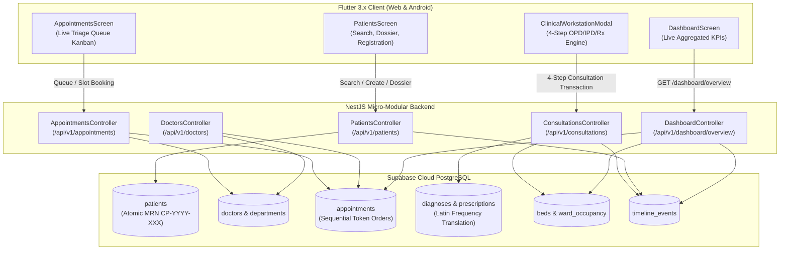

# Phase 5 — Core Clinical Workflows (OPD / IPD / Rx)

## 1. Executive Summary

Phase 5 transitions the Hospital Management System (HMS) from foundational identity, database, and shell architecture into active clinical operations. It delivers end-to-end OPD (Outpatient Department), IPD (Inpatient Department), and Rx (e-Prescribing) clinical workflows across the NestJS backend and multi-platform Flutter client, connected directly to the live cloud **Supabase PostgreSQL** instance.

---

## 2. Architecture & Clinical Data Flow

---

## 3. Core Clinical Backend Modules

### 3.1. `PatientsModule` (`apps/backend/src/modules/patients/`)
* **Atomic Medical Record Number (MRN)**: Automatically formats MRNs using the sequence algorithm:
  $$\text{MRN} = \text{CP-} + \text{Year} + \text{-} + \text{Pad3}(\text{TotalPatients} + 1)$$
  Example: `CP-2026-001`, `CP-2026-002`.
* **Biometric QR Identifier**: Generates a cryptographically unique UUID `qrToken` for patient identification.
* **Duplicate Detection Engine** (`POST /api/v1/patients/check-duplicate`): Validates input against existing records by exact and fuzzy matches on `(name, surname, phone)` to prevent accidental duplicate dossier creation.
* **Longitudinal Clinical Dossier** (`GET /api/v1/patients/:id/dossier`): Returns a comprehensive longitudinal clinical record including past visits, chief complaints, ICD-10 diagnoses, active medications, doctor notes, patient files, and timeline logs.

### 3.2. `DoctorsModule` (`apps/backend/src/modules/doctors/`)
* **Doctor Directory & Department Mappings** (`GET /api/v1/doctors`): Queries active consultants with department linkage, medical qualifications, experience, and consultation fees.
* **Slot Collision Engine** (`GET /api/v1/doctors/:id/slots?date=YYYY-MM-DD`): Computes 30-minute consultation slots (from morning to evening OPD hours), cross-referencing against booked appointments for the selected date to prevent double bookings.

### 3.3. `AppointmentsModule` (`apps/backend/src/modules/appointments/`)
* **Anti-Collision Slot Booking** (`POST /api/v1/appointments`): Locks the doctor time slot and calculates the daily sequential token number:
  $$\text{TokenNumber} = \text{Count}(\text{Appointments for Doctor on Date}) + 1$$
* **Live Patient Triage Queue** (`GET /api/v1/appointments/queue`): Groups today's active appointments into four progression stages:
  1. `Waiting` (Stage 1: In OPD waiting lobby)
  2. `In Consultation` (Stage 2: Doctor actively examining patient)
  3. `Observation / Tests` (Stage 3: Labs, vitals monitoring, or pre-admission)
  4. `Completed` (Stage 4: Signed off and discharged)
* **Stage Progression** (`PATCH /api/v1/appointments/:id/stage`): Atomically updates the appointment's stage, status, and transition notes.

### 3.4. `ConsultationsModule` (`apps/backend/src/modules/consultations/`)
* **Atomic Multi-Table Transaction** (`POST /api/v1/consultations/:appointmentId`):
  1. Removes previous drafts if re-saving.
  2. Inserts ICD-10 clinical diagnoses.
  3. Inserts prescription items with **Latin Frequency Translation**:
     - `TID` $\rightarrow$ "Three times daily (Morning, Noon, Night)"
     - `BID` $\rightarrow$ "Twice daily (Morning, Night)"
     - `OD` $\rightarrow$ "Once daily"
     - `QID` $\rightarrow$ "Four times daily"
     - `HS` $\rightarrow$ "At bedtime"
     - `SOS` $\rightarrow$ "As needed / In emergency"
  4. Handles clinical disposition (`Discharged`, `Waiting for Reports`, `Admitted to Ward`, `Admitted to ICU`). If admitted, links bed number and sets bed status to `Occupied`.
  5. Updates appointment stage to `Completed` (or `Observation`), appends doctor clinical summary notes, and logs a timeline event.

### 3.5. `DashboardModule` (`apps/backend/src/modules/dashboard/`)
* **Aggregated Real-time Hospital KPIs** (`GET /api/v1/dashboard/overview`):
  - Total registered patients
  - Today's appointment counts
  - Waiting queue length & active consultations
  - Inpatient bed occupancy (`occupied`, `total`, and `ratePercent`)
  - Active doctors on duty
  - Real-time longitudinal event activity feed

---

## 4. Multi-Platform Flutter Client Architecture

### 4.1. Domain Models & Repositories
* `Patient` (`apps/frontend/lib/features/patients/domain/models/patient.dart`)
* `Doctor` & `DoctorSlotItem` (`apps/frontend/lib/features/doctors/domain/models/doctor.dart`)
* `Appointment`, `DiagnosisItem`, `PrescriptionItem` (`apps/frontend/lib/features/appointments/domain/models/appointment.dart`)
* `DashboardOverview`, `DashboardKpis`, `BedOccupancy` (`apps/frontend/lib/features/dashboard/domain/models/dashboard_overview.dart`)
* Feature Repositories: `PatientsRepository`, `DoctorsRepository`, `AppointmentsRepository`, `DashboardRepository`.

### 4.2. Riverpod 2.x State Management
* `dashboardOverviewProvider`: `FutureProvider` with live refresh capabilities.
* `patientsProvider`: `NotifierProvider<PatientsNotifier, PatientsState>` managing debounced search, pagination, and patient creation.
* `patientDossierProvider`: `FutureProvider.family` retrieving longitudinal dossiers on demand.
* `doctorsListProvider`: `FutureProvider` providing active consultant rosters.
* `appointmentsProvider`: `NotifierProvider` managing appointment date filtering and booking.
* `queueProvider`: `NotifierProvider<QueueNotifier, QueueState>` managing 4-stage live queue updates and consultation sign-offs.

### 4.3. Interactive Clinical Workstation & UI Screens
1. **`DashboardScreen`**:
   - Live KPI cards with real-time bed occupancy percentages and active queues.
   - Quick action shortcuts (Register Walk-in, Book Appointment, Live Triage Queue, BHOOMA AI).
   - Real-time clinical activity feed.
2. **`PatientsScreen` & Modals**:
   - Paginated searchable patient directory.
   - `PatientRegistrationDialog`: Form with live duplicate checking banner and atomic MRN assignment.
   - `PatientDossierModal`: Multi-tab clinical dossier displaying longitudinal visits, ICD-10 diagnoses, prescribed medications, and timeline history.
3. **`AppointmentsScreen` & Modals**:
   - Tab 1: **Live Triage Queue (Token Order)** with stage counter badges and progression action buttons (`Call Patient`, `Open Clinical Workstation`, `Discharge / Complete`).
   - Tab 2: **All Scheduled Appointments** with date filter and workstation shortcuts.
   - `AppointmentBookingDialog`: Doctor slot selector with conflict detection and sequential token numbering.
   - `ClinicalWorkstationModal`: 4-Step clinical workspace:
     - Step 1: ICD-10 Diagnoses with quick-pick chips.
     - Step 2: Prescription builder with Latin frequency tags.
     - Step 3: Disposition & inpatient bed allocation (`ICU-01`, `PVT-01`, etc.).
     - Step 4: Doctor clinical advice and sign-off.
4. **`DoctorsScreen`**:
   - Consultant roster with department chips, medical qualifications, consultation fees, and slot booking shortcuts.

---

## 5. Verification & Quality Assurance

### 5.1. Backend Build
* **Command**: `npm run build`
* **Result**: `nest build` completed with **code 0** (0 TypeScript errors).

### 5.2. Frontend Static Analysis
* **Command**: `flutter analyze`
* **Result**: **No issues found!** (ran in 7.1s, 0 errors, 0 warnings).

### 5.3. Frontend Automated Unit & Domain Test Suite
* **Command**: `flutter test`
* **Result**: All 5 test suites passed:
  - `Patient model parses correctly and exposes clinical getters`
  - `Doctor and Slot models parse properly with booking collision detection`
  - `Appointment model parses with diagnoses and prescriptions`
  - `DashboardOverview parses live aggregated KPIs`
  - `HospitalApp launches successfully smoke test`

### 5.4. Production Multi-Platform Bundles
* **Web Target**:
  - `flutter build web`
  - Result: Built `build\web` in 76.3s with CanvasKit optimization and tree-shaken font assets.
* **Android Target**:
  - `flutter build apk`
  - Result: Built standalone release package `build\app\outputs\flutter-apk\app-release.apk` (49.7MB).
